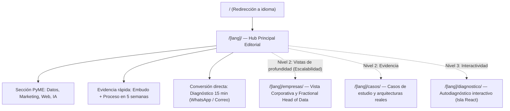

# Signum & Co. — Plan de Escalabilidad, Experiencia UX/UI y Plan de Acción

Fecha: 10 de noviembre de 2026  
Estado: Propuesta estratégica y plan de acción ejecutable  
Base actual: Astro 5 + TypeScript + Tailwind CSS v4 (`/es/` y `/en/`)

---

## 1. Diagnóstico de Arquitectura: ¿Todo en una sola vista o separado en vistas?

### El reto actual del catálogo de Signum & Co.
Al analizar la oferta actual del sitio, conviven **dos perfiles de comprador con ciclos de decisión muy distintos**:

1. **Comercio y PyME en crecimiento (`Qué hacemos`):**
   - *Qué busca:* Saber qué anuncio o publicación le trae ventas, instalar GA4/Tag Manager, mejorar su web o poner un asistente de WhatsApp 24/7.
   - *Cómo decide:* Rápido, guiado por confianza práctica, ejemplos claros (el embudo de 1.000 visitas) y contacto directo por WhatsApp.
2. **Empresa mediana y corporativo (`Para empresas`):**
   - *Qué busca:* Inteligencia de ingresos (RevOps), ingeniería de datos (Snowflake, BigQuery, Databricks), tableros ejecutivos (Tableau, Power BI), IA sobre documentos internos, controles de riesgo/cumplimiento bancario (AML) o un *Líder de datos por horas*.
   - *Cómo decide:* Evalúa rigor técnico, arquitectura, gobernanza, experiencia del fundador y modalidades de contratación (proyecto vs. bolsa de horas).

### Recomendación: Arquitectura Híbrida "Hub & Spoke" (Progresiva)

> **Veredicto:** No conviene fragmentar el sitio en 10 páginas cortas de inmediato (eso obliga al usuario a dar clics innecesarios y diluye la narrativa), pero **tampoco conviene dejar toda la profundidad corporativa comprimida para siempre en una sola página**. La estructura ideal para una consultora de alto valor es un **Hub principal de conversión** complementado por **vistas especializadas por audiencia y evidencia**.

#### Cómo distribuir las vistas por etapas:
- **Etapa Inmediata (Optimización de la vista única actual):**
  - Mantener la página principal `/[lang]/` como el **Hub completo**, pero añadiendo un **selector rápido de perfil** debajo del Hero (*"Para negocios y comercios"* vs. *"Para empresas y dirección"*) y enlaces de acción contextuales en cada bloque que pre-llenen el formulario de contacto con el tema elegido.
- **Etapa Media (Separación en 3 vistas estratégicas):**
  1. **`/[lang]/` (Inicio / Hub general):** Propuesta de valor, el problema de las preguntas sin respuesta, resumen de las 4 áreas de servicio, el embudo, proceso de 5 semanas, resumen de empresa y contacto.
  2. **`/[lang]/empresas/` (`/en/enterprise/`):** Vista dedicada a gerencias de Ventas, Finanzas, Operaciones y TI. Aquí se amplía el detalle de *Inteligencia de Ingresos (RevOps)*, *Ingeniería de Datos (Snowflake/Databricks/BigQuery)*, *Riesgo y Cumplimiento (AML)* y el modelo de *Líder de datos por horas*, con diagramas de arquitectura limpios.
  3. **`/[lang]/casos/` (`/en/cases/`):** 3 a 4 casos reales (anonimizados) con formato editorial: *Contexto → Señal oculta en los datos → Intervención de Signum & Co. → Resultado medible*.

---

## 2. Cómo mantener la personalidad editorial y maximizar la conversión

La mayor fortaleza visual de Signum & Co. es su **sobriedad editorial ("Quiet Rigor")**: no parece una plantilla genérica de agencia de marketing llena de iconos brillantes o promesas exageradas.

### Reglas para conservar el ADN visual
1. **Tipografía con rol estricto:**
   - *Libre Caslon Text*: reservada para titulares (`h1`, `h2`, `h3` de filas), citas (`q`) y métricas clave (`12+`, `5`). Transmite criterio senior y firma consultora.
   - *Schibsted Grotesk*: cuerpo de lectura, interfaz, botones y tablas.
   - *IBM Plex Mono*: exclusivamente para señales técnicas reales (`utm_source=...`, `page_view`, `generate_lead`, `SQL`, `GA4`).
2. **El dorado (`#c9a227`) como "señal", nunca como decoración masiva:**
   - En la gráfica del Hero, los puntos grises/azulados son el ruido y la línea dorada es la señal. Esa misma metáfora debe gobernar toda la interfaz: el dorado solo aparece en el CTA principal, el indicador activo de navegación, la última barra del embudo (`purchase`) y los bordes de foco/interacción.
3. **Filas de definición (`.svc-row`) en lugar de cajas (cards):**
   - Conservar las líneas divisorias horizontales de estilo editorial y el indicador vertical dorado al pasar el cursor.

### Mejoras UX/UI para maximizar conversión sin perder sobriedad
- **CTAs contextuales por sección (Pre-llenado inteligente):**
  - En lugar de que el usuario tenga que bajar manualmente hasta el formulario y escribir desde cero, añadir un enlace discreto al final de las secciones clave:
    - En *Qué hacemos*: `Solicitar diagnóstico de medición y marketing →`
    - En *Para empresas*: `Conversar sobre ingeniería de datos o liderazgo por horas →`
    - En *Cómo trabajar juntos*: `Cotizar proyecto a precio fijo →`
  - Al hacer clic, hace scroll suave a `#contacto` y pre-selecciona el interés en el campo `¿Qué le gustaría saber o resolver?`, actualizando al instante la vista previa de WhatsApp y correo.
- **Micro-diagramas editoriales en SVG:**
  - Así como el Hero tiene una gráfica memorable y la sección del embudo tiene barras logarítmicas, la sección *Para empresas* puede incluir un esquema lineal minimalista (en trazos finos y texto monoespaciado) que muestre cómo fluye el dato: `Fuentes (CRM / ERP / Ads) → Almacén (Snowflake / BigQuery) → Tablero Lunes 8:00 a.m.`.

---

## 3. Normalización de Idioma (`ES / EN`) y Modo Claro / Oscuro (Bright & Dark)

### 3.1. Experiencia bilingüe (`ES / EN`) sin fricción
Actualmente `/es/` y `/en/` son rutas estáticas independientes (óptimo para SEO y `hreflang`). Para que la experiencia de usuario sea impecable:
- **Conservación de ancla y scroll al cambiar de idioma:** Si el usuario está leyendo la sección `#empresas` o `#precios` en español y pulsa `EN`, el selector debe llevarlo a `/en/#empresas` o `/en/#precios` (conservando la sección equivalente) en lugar de devolverlo al tope de la página.
- **Persistencia de borrador en el formulario (`sessionStorage`):** Si el usuario empezó a escribir su nombre o empresa en el formulario y cambia entre `ES` y `EN`, conservar los valores de los campos y regenerar la vista previa en el nuevo idioma.

### 3.2. Normalización del Modo Claro (Bright) y Modo Oscuro (Dark)
En el prototipo original, el sitio mezcla secciones siempre oscuras (`Hero`, `Header`, `Contact`, `Footer`) con secciones intermedias que cambian según el sistema operativo, sin que el usuario pueda elegir el tema manualmente.

#### Propuesta de normalización visual:
1. **Control explícito de tema en el encabezado (`Claro` / `Oscuro`):**
   - Añadir un botón con icono minimalista (Sol / Luna) junto al selector `ES / EN`.
   - Ejecutar un script inline ultraligero en `<head>` que lea `localStorage.getItem('sg-theme')` o `prefers-color-scheme` antes del primer pintado para **evitar cualquier parpadeo (FOUC)**.
2. **Paleta Modo Claro (Bright) refinada y luminosa:**
   - `--bg`: `#f6f7f9` (gris papel cálido muy sutil).
   - `--surface`: `#ffffff` (blanco puro para secciones alternas `.sec-alt`).
   - `--fg`: `#0f1a2e` (azul tinta profundo para máxima legibilidad).
   - `--muted`: `#4a5568` (contraste AA holgado en textos secundarios).
   - `--gold-ink`: `#7a5e0a` (dorado bronce oscuro para textos pequeños y marcadores sobre fondo claro).
   - `--line`: `#dde2ea` (divisores limpios).
   - *Hero y Contacto en Modo Claro:* Mantener el bloque marino institucional (`#0f1f3d`) como ancla de marca o suavizar su transición con un borde superior/inferior dorado sutil (`1px solid rgba(201, 162, 39, 0.25)`).
3. **Paleta Modo Oscuro (Dark) unificada y sin saltos bruscos:**
   - `--navy` (Hero / Nav / Contacto): `#070e1c` (azul noche profundo).
   - `--bg` (Secciones pares): `#0a1324` (azul abisal).
   - `--surface` (Secciones impares `.sec-alt`): `#0f1c33` (superficie elevada con diferenciación clara pero armónica).
   - `--fg`: `#edf1f7` (blanco hueso suave, sin deslumbrar).
   - `--muted`: `#9fb0c9` (gris azulado claro con contraste verificado).
   - `--gold-ink`: `#dfc05a` (dorado luminoso para etiquetas `.code` y numeración).
   - `--line`: `#1e2f4d` (líneas divisorias nítidas).

---

## 4. Plan de Optimización Responsive (Versión Mobile)

Aunque el sitio ya cuenta con reglas base para pantallas pequeñas, una experiencia móvil de primer nivel para clientes que entran desde enlaces de Instagram o WhatsApp requiere pulir 5 puntos críticos:

### 4.1. Encabezado y Menú Móvil (`< 780px`)
- **Problema actual:** Al abrir el menú en móvil, los enlaces se apilan en flujo simple sin jerarquía visual ni llamada a la acción directa.
- **Solución:**
  - Diseñar un panel desplegable limpio bajo el encabezado con enlaces de `48px` de alto, separadores sutiles, estado activo claro y un botón directo de WhatsApp al pie del menú móvil.
  - Mantener siempre visibles en la barra superior: el logotipo `Signum & Co.`, el selector `ES / EN`, el botón de tema `Claro / Oscuro` y el botón de menú.

### 4.2. Hero y Gráfica Interactiva en Móvil (`< 640px`)
- **Problema actual:** En pantallas de `360px` a `412px`, el `viewBox="0 0 1080 260"` hace que la gráfica se vea muy baja (`~80px` de alto) y los puntos sean diminutos al tacto.
- **Solución:**
  - Ajustar las proporciones en móvil (`min-height: 150px` o ajuste de escala vertical en pantallas pequeñas) y ampliar el área táctil para que deslizar el dedo sobre la gráfica sea cómodo sin bloquear el scroll vertical (`touch-action: pan-y`).
  - Hacer que los botones CTA del Hero ocupen el `100%` del ancho en pantallas `< 480px` para facilitar el clic con el pulgar.

### 4.3. Lectura de Secciones Extensas (`Qué hacemos` y `Para empresas`)
- **Problema actual:** Entre `Qué hacemos` (4 filas) y `Para empresas` (5 filas) hay 9 bloques detallados seguidos. En móvil, esto genera un scroll muy largo antes de llegar al embudo y al formulario.
- **Solución:**
  - Añadir numeración editorial sutil (`01`, `02`, `03`...) y mejorar el espaciado interno en móvil (`padding-block: 24px`, títulos con mejor contraste y listas compactas).
  - Incorporar un **acordeón progresivo opcional en móvil** o pestañas de salto rápido (`Servicios` · `Empresas` · `Precios` · `Contacto`) para que el usuario móvil pueda ir directo al bloque de su interés sin perder el contenido en el DOM.

### 4.4. Embudo y Proceso en Pantallas Pequeñas (`< 600px`)
- **Embudo:** Alinear en una sola fila superior el nombre del paso + el código `.code` (`page_view`) y el valor numérico (`1.000`), dejando la barra de progreso debajo a ancho completo para que la proporción logarítmica se aprecie con total claridad en pantallas de `360px`.
- **Proceso (4 pasos):** En móvil (`< 520px`), conectar los pasos `1 → 2 → 3 → 4` mediante una línea vertical izquierda (formato timeline) para reforzar la idea de secuencia de 5 semanas.

### 4.5. Barra de Acción Móvil Discreta (Sticky Mobile CTA)
- Añadir una barra inferior compacta (solo en pantallas `< 640px`) que aparezca suavemente cuando el usuario haya pasado el Hero y se oculte automáticamente al llegar a la sección `#contacto`. Contendrá un único botón directo: `Pedir diagnóstico gratis (15 min)`.

---

## 5. Plan de Acción Ejecutable (Fases de Trabajo)

### Sprint 1 — Normalización de Tema (Claro/Oscuro), Idioma y Responsive Móvil (Prioridad Alta)
- [ ] **1.1. Conmutador de Tema (Bright / Dark):**
  - Implementar script anti-FOUC en `BaseLayout.astro`.
  - Agregar botón de cambio de tema (Sol/Luna) en `Header.astro` con persistencia en `localStorage`.
  - Normalizar las variables CSS en `tokens.css` para que el modo claro y el modo oscuro tengan contraste verificado y transiciones suaves.
- [ ] **1.2. Selector `ES / EN` con memoria de sección y formulario:**
  - Conservar el hash de la sección activa (`#servicios`, `#empresas`, `#precios`, `#contacto`) al cambiar entre `/es/` y `/en/`.
  - Conservar los datos escritos en el formulario en `sessionStorage` al alternar el idioma.
- [ ] **1.3. Pulido Responsive Mobile-First (`360px` – `768px`):**
  - Rediseñar el menú desplegable móvil con áreas táctiles de `48px`, cierre al tocar fuera y transiciones limpias.
  - Optimizar el layout móvil del embudo (`.f-row`), la línea de tiempo del proceso (`.steps`) y las alturas de la gráfica SVG en móvil.
  - Hacer que los botones CTA del Hero sean de ancho completo en `< 480px`.

### Sprint 2 — Optimización de Conversión UX en Servicios (Prioridad Media-Alta)
- [ ] **2.1. CTAs contextuales con pre-llenado del formulario:**
  - Añadir botones de acción específicos al pie de *Qué hacemos*, *Para empresas* y *Cómo puede trabajar con nosotros* que lleven a `#contacto` y pre-carguen el tema en el mensaje de WhatsApp/correo.
- [ ] **2.2. Navegación rápida por perfil de cliente:**
  - Añadir índice rápido o diferenciador visual claro entre la oferta para negocios locales y la oferta corporativa (*Enterprise*).

### Sprint 3 — Escalabilidad a Múltiples Vistas (Prioridad Media, según crecimiento de contenido)
- [ ] **3.1. Vista dedicada `/[lang]/empresas/` (`/en/enterprise/`):**
  - Página enfocada en dirección general, finanzas y TI con detalle de arquitectura de datos, casos de RevOps y modalidad *Líder de datos por horas*.
- [ ] **3.2. Vista de evidencia `/[lang]/casos/` (`/en/cases/`):**
  - Plantilla estandarizada para publicar casos de éxito reales y medibles sin romper la estética editorial.
- [ ] **3.3. Isla interactiva en React (Diagnóstico rápido / Calculadora de embudo):**
  - Primer componente con estado en `src/components/interactive/` donde el visitante ingresa sus visitas mensuales aproximadas y obtiene una estimación visual de su embudo.
